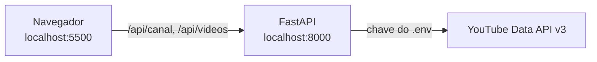

# Projeto APIs: REST, YouTube API, SOAP, GraphQL e gRPC

Atividade prática da disciplina sobre **APIs e web services**. O projeto implementa, em várias
linguagens, os principais estilos de comunicação entre sistemas:

| Tecnologia | O que foi feito | Linguagens |
|---|---|---|
| **REST** | Cotações de moedas (AwesomeAPI) e do IBOVESPA (Yahoo! Finance) | Python |
| **REST + YouTube Data API v3** | Galeria de vídeos de canais do YouTube, com pesquisa, paginação e player em modal | JavaScript, Python (FastAPI) |
| **SOAP** | Serviço de consulta de pedidos descrito por WSDL (estilos rpc/literal e document/literal) | PHP, Java |
| **GraphQL** | API de pedidos com consultas e mutações | PHP (servidor e clientes), Java (cliente) |
| **gRPC** | Serviço de consulta de pedidos com Protocol Buffers | Java |

Os exemplos de SOAP, GraphQL e gRPC usam o **mesmo domínio**, uma consulta de pedidos (`PED-1001`,
`PED-1002`...). Assim dá para comparar como cada tecnologia resolve o mesmo problema.

> O PDF da atividade com todos os prints está em [`entrega/APIs-com-prints.pdf`](entrega/APIs-com-prints.pdf).
> A pasta [`prints/`](prints/) tem os prints separados por tema, com um índice no [README](prints/README.md).

---

## Estrutura do repositório

```
.
├── apis-python/                  # REST com Python
│   ├── requirements.txt
│   └── REST/
│       ├── moedas.py             # Cotações de dólar, euro e bitcoin (AwesomeAPI)
│       └── cotacoes.py           # IBOVESPA 2025 com yfinance + gráfico matplotlib
│
├── apis-javascript/API YouTube/  # Estudo de caso com a YouTube Data API v3
│   ├── v4/                       # Front-end puro: o navegador chama o YouTube direto
│   └── v5/
│       ├── backend/              # API própria em FastAPI (guarda a chave no .env)
│       └── frontend/             # Front-end que consome o back-end
│
├── apis-php/
│   ├── soap-pedidos-php/         # Servidores e clientes SOAP (rpc e document/literal)
│   └── graphql-pedidos-php/      # Servidor GraphQL + clientes (consulta e mutações)
│
├── apis-java/                    # Projeto Maven
│   └── src/main/
│       ├── java/com/exemplo/pedidos/
│       │   ├── ClientePedido.java, ServidorPedido.java, PedidoPortTypeImpl.java   # SOAP rpc
│       │   ├── documento/        # SOAP document/literal
│       │   ├── graphql/          # Cliente GraphQL
│       │   └── grpc/             # Servidor e cliente gRPC
│       ├── proto/pedidos.proto   # Contrato gRPC
│       └── resources/wsdl/       # Contratos SOAP (WSDL)
│
├── prints/                       # Prints dos exercícios
└── entrega/                      # PDF da atividade com os prints
```

## Pré-requisitos

| Ferramenta | Versão usada | Observação |
|---|---|---|
| Python | 3.10+ | Para REST e para o back-end da V5 |
| PHP | 8.3+ | Extensões `soap` e `sockets` habilitadas no `php.ini` |
| Composer | 2.x | Instala a biblioteca `webonyx/graphql-php` |
| JDK | 17+ | O `pom.xml` compila para Java 17 (o PDF sugere JDK 25) |
| Maven | 3.9+ | Ou o Maven embutido no IntelliJ |
| VS Code | – | Com a extensão **Live Server**, para o front-end |

Você também vai precisar de uma **chave da YouTube Data API v3**, criada no Google Cloud Console.

## Portas usadas

| Porta | Serviço |
|---|---|
| `8000` | Back-end FastAPI (YouTube V5) |
| `5500` | Front-end (Live Server ou `python -m http.server`) |
| `8081` | Servidor SOAP rpc/literal (PHP **ou** Java) |
| `8082` | Servidor SOAP document/literal **ou** servidor GraphQL |
| `50051` | Servidor gRPC |

> A porta `8082` é usada por dois servidores diferentes. Rode um de cada vez.

---

## 1. REST com Python

Os scripts fazem requisições HTTP a APIs públicas e tratam o JSON retornado.

- **`moedas.py`**: consulta `https://economia.awesomeapi.com.br/last/USD-BRL,EUR-BRL,BTC-BRL`,
  mostra o JSON com as cotações do dólar, do euro e do bitcoin e, depois, só o valor de compra
  (`bid`) do dólar.
- **`cotacoes.py`**: baixa o histórico do IBOVESPA (`^BVSP`) de 2025 com `yfinance` e gera um
  gráfico do fechamento com `matplotlib`.

```bash
cd apis-python
python -m venv .venv
.venv\Scripts\activate          # no Linux/macOS: source .venv/bin/activate
pip install -r requirements.txt
python REST/moedas.py
python REST/cotacoes.py
```

## 2. Estudo de caso: YouTube Data API v3

Aplicação web que lista os vídeos mais recentes de um canal (Unoesc, Google for Developers e
NASA), com pesquisa, botão "Carregar mais" (paginação por `pageToken`) e player em janela modal.

Para listar os vídeos, a aplicação faz duas chamadas à API do YouTube:
1. `channels?forHandle=@canal`: descobre a playlist **uploads** do canal.
2. `playlistItems?playlistId=...`: lista os vídeos dessa playlist, 12 por página.

### Versão 4: só front-end

O navegador chama a API do YouTube diretamente, então a chave fica no `script.js`.

1. Em `apis-javascript/API YouTube/v4/assets/js/script.js`, troque `<Insira sua chave aqui>` pela sua chave.
2. Abra o `index.html` com o **Live Server** do VS Code.

> Nessa versão qualquer pessoa consegue ver a chave pelo navegador. É justamente o problema que a V5 resolve.

### Versão 5: front-end + back-end FastAPI

O navegador passa a conversar com uma **API própria**, e só o servidor conhece a chave, que fica
no arquivo `.env`.



| Endpoint | Parâmetros | Retorno |
|---|---|---|
| `GET /api/canal` | `handle` (ex.: `@unoescoficial`) | Título do canal e ID da playlist de uploads |
| `GET /api/videos` | `playlist`, `page_token` (opcional), `max_results` (1 a 50, padrão 12) | Vídeos da página e o token da próxima |

**Back-end:**
```bash
cd "apis-javascript/API YouTube/v5/backend"
python -m venv .venv
.venv\Scripts\activate
pip install -r requirements.txt
copy .env.example .env          # depois edite o .env e coloque a sua chave em YOUTUBE_API_KEY
uvicorn app:app --reload
```

**Front-end** (em outro terminal):
```bash
cd "apis-javascript/API YouTube/v5/frontend"
python -m http.server 5500
```

Depois, abra `http://localhost:5500/`. A documentação automática da API fica em `http://localhost:8000/docs`.

> **Segurança:** o `.env` está no `.gitignore` e **nunca** deve ir para o GitHub. Só o
> `.env.example`, sem a chave real, é versionado.

## 3. SOAP

Serviço de **consulta de pedidos** definido por um contrato **WSDL** (`pedido.wsdl`). A operação
`consultarPedido` recebe o número do pedido e devolve número, cliente, status e valor total.
Se o pedido não existe (`PED-9999`), o servidor responde com uma **SOAP Fault**.

São duas variações:
- **rpc/literal** (`pedido.wsdl`, porta 8081)
- **document/literal wrapped** (`pedido-documento.wsdl`, porta 8082)

Como servidores e clientes seguem o mesmo WSDL, PHP e Java conversam entre si em qualquer combinação.

### PHP

```bash
cd apis-php/soap-pedidos-php

# Terminal 1: servidor rpc/literal (porta 8081)
php iniciar-servidor.php        # no Linux/macOS: php -S 127.0.0.1:8081 -t . servidor.php

# Terminal 2: cliente (mostra o XML enviado e recebido)
php cliente.php
php cliente.php PED-9999        # pedido inexistente → SOAP Fault
```

Versão document/literal:
```bash
php -S 127.0.0.1:8082 -t . servidor-documento.php
php cliente-documento.php
```

> `iniciar-servidor.php` verifica se a porta está livre com a opção `SO_EXCLUSIVEADDRUSE`,
> que só existe no Windows. No Linux ou macOS, use o comando `php -S` indicado no comentário acima.

### Java

O plugin `cxf-codegen-plugin` gera as classes Java a partir dos WSDL na compilação:

```bash
cd apis-java
mvn compile
```

Depois, rode as classes pelo IntelliJ (botão ▶):

| Classe | Papel |
|---|---|
| `com.exemplo.pedidos.ServidorPedido` | Servidor SOAP rpc/literal (8081) |
| `com.exemplo.pedidos.ClientePedido` | Cliente rpc/literal: funciona com o servidor PHP ou Java |
| `com.exemplo.pedidos.documento.ServidorPedidoDocumento` | Servidor document/literal (8082) |
| `com.exemplo.pedidos.documento.ClientePedidoDocumento` | Cliente document/literal |

## 4. GraphQL

O servidor PHP usa a biblioteca **webonyx/graphql-php** e expõe um esquema tipado em
`http://127.0.0.1:8082/graphql`. Os dados ficam salvos em `pedidos.json`, que é criado
automaticamente e está no `.gitignore`.

| Operação | Tipo | O que faz |
|---|---|---|
| `pedido(numero)` | Query | Consulta um pedido. O cliente escolhe quais campos quer receber. |
| `atualizarStatusPedido(numeroPedido, novoStatus)` | Mutation | Altera o status de um pedido |
| `criarPedido(pedido: PedidoInput)` | Mutation | Cadastra um novo pedido |

```bash
cd apis-php/graphql-pedidos-php
composer install

# Terminal 1: servidor
php -S 127.0.0.1:8082 -t . servidor-graphql.php

# Terminal 2: clientes
php consulta.php        # consulta completa e resumida (mostra a escolha de campos)
php mutacao.php         # muda o status do PED-1001 para "Em transporte"
php criar-pedido.php    # cria o PED-1003
```

O cliente Java (`com.exemplo.pedidos.graphql.ClienteGraphQL`) faz as mesmas consultas usando o
`HttpClient` nativo do Java.

## 5. gRPC

O contrato fica em `apis-java/src/main/proto/pedidos.proto`:

```proto
service PedidoService {
  rpc ConsultarPedido (ConsultarPedidoRequest) returns (Pedido);
}
```

Na compilação (`mvn compile`), o `protobuf-maven-plugin` gera as classes e os *stubs*. O
servidor roda na porta **50051** e usa HTTP/2 com mensagens binárias em Protocol Buffers.

1. Rode `com.exemplo.pedidos.grpc.ServidorPedido`.
2. Rode `com.exemplo.pedidos.grpc.ClientePedidoGrpc`. Ele consulta o `PED-1001`.
3. Rode o cliente de novo passando `PED-9999` como argumento. O servidor responde com o status `NOT_FOUND`.

> Os avisos `SLF4J(W): No SLF4J providers were found` e `sun.misc.Unsafe` que aparecem no console
> não são erros: o projeto só não tem uma biblioteca de log configurada.

---

## Comparativo rápido

| | REST | SOAP | GraphQL | gRPC |
|---|---|---|---|---|
| Formato | JSON | XML | JSON | Protocol Buffers (binário) |
| Contrato | Opcional (OpenAPI) | WSDL obrigatório | Esquema tipado | Arquivo `.proto` |
| Transporte | HTTP | HTTP | HTTP (um único endpoint) | HTTP/2 |
| Erros | Código HTTP | SOAP Fault | Lista `errors` no JSON | Status (`NOT_FOUND` etc.) |
| Ponto forte | Simples e universal | Contrato rígido, padrão corporativo | Cliente escolhe os campos | Desempenho entre serviços |
